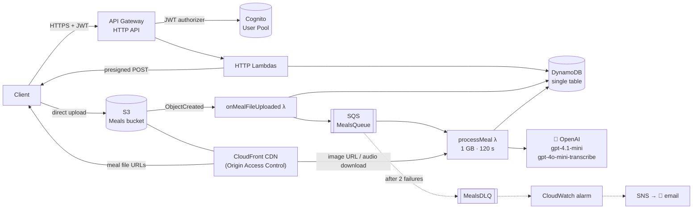
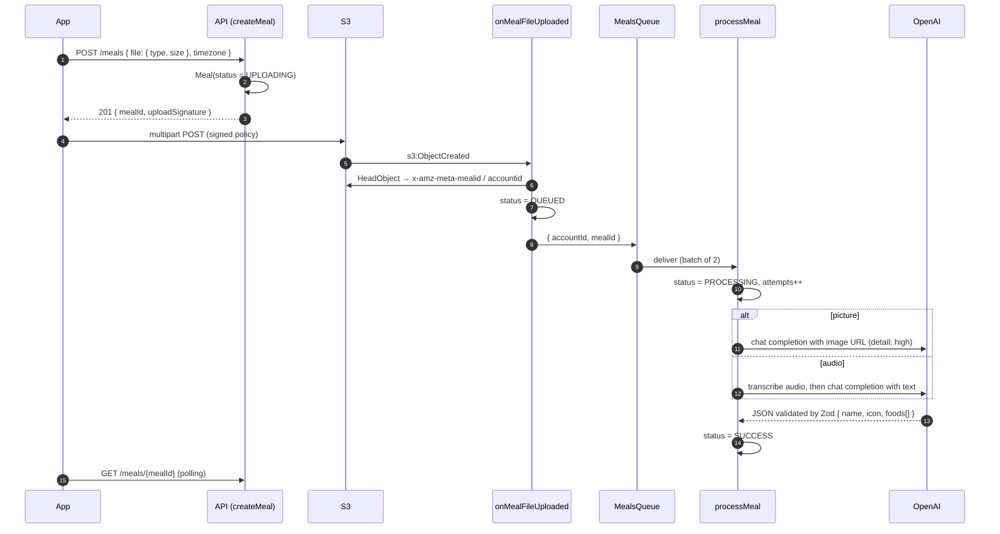
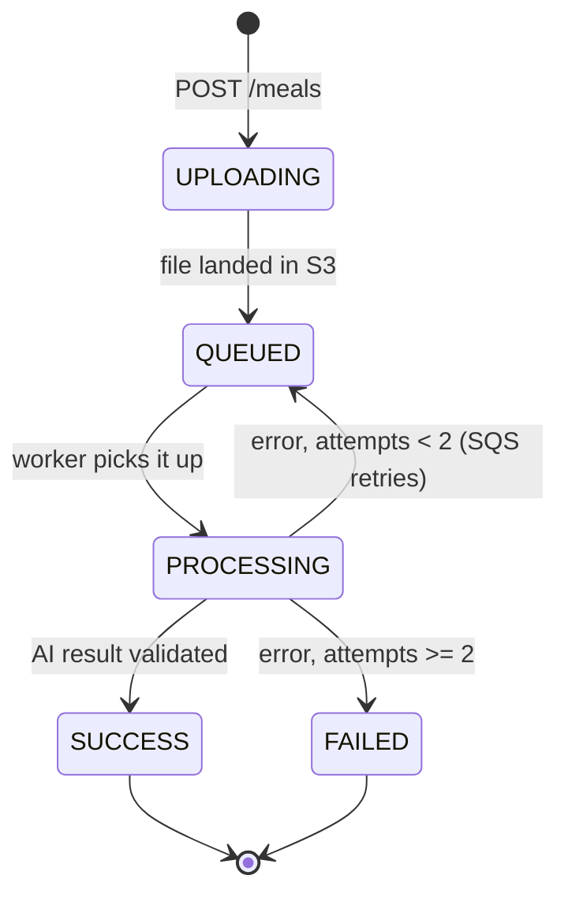
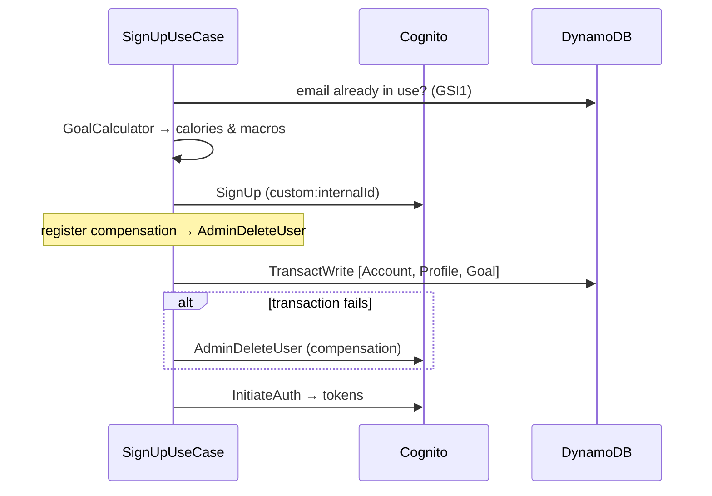

# 🍏 Foodiary API

> A serverless, event-driven backend for a food diary where users log meals by **snapping a photo** or **recording a voice note**. An AI pipeline then identifies the foods and estimates portions, calories, and macronutrients asynchronously.


This is not a CRUD app with an LLM bolted on. It's a **production-shaped AWS architecture** built from the ground up. Each layer has a clear job:

- Direct-to-S3 uploads with signed, size-locked policies
- An S3 → SQS → Lambda pipeline with retries, a dead-letter queue, and alerting
- A single-table DynamoDB design with timezone-aware access patterns
- Cognito authentication with custom token claims
- Saga-based compensation across services
- A hand-rolled dependency injection container
- Infrastructure as code that can be deployed as a fully isolated `dev` or `prod` stack

---

## 🎯 The problem

Calorie tracking apps fail for one simple reason: **logging food is tedious**. You search a database, guess a portion, and repeat that for every ingredient of every meal. Most people give up within a week.

Foodiary removes the typing:

- 📸 **Take a picture of your plate** and the AI identifies each visible food and estimates its weight in grams.
- 🎙️ **Or just say what you ate** ("rice, beans and a grilled chicken breast"). The audio is transcribed and analyzed the same way.
- 🎯 **Get personalized daily goals.** Calories and macros are calculated from your body metrics, activity level, and objective (lose, maintain, or gain).
- 📅 **See your day at a glance.** Meals are grouped by _your_ local day, wherever you are.

---

## 🧱 Architecture



Each Lambda is bundled **individually** with esbuild + SWC: minified, with the AWS SDK left out because the runtime already provides it. Every function runs on **arm64 (Graviton)** with 128 MB by default. Only the AI worker gets 1 GB and a longer timeout, because it's the only one that needs them.

---

## 🍽️ How a meal is processed

Logging a meal is **fully asynchronous**. The API never receives the file, and the client never waits for the AI.



### Meal lifecycle



The processing use case is **idempotent and defensive**:

- A redelivered message for a `SUCCESS` meal is a no-op.
- A message for a meal that is still `UPLOADING` or already `PROCESSING` is rejected, so SQS retries it later instead of processing it twice.
- The app's retry budget (`MAX_ATTEMPTS = 2`) matches the queue's `maxReceiveCount: 2`, so a meal is marked `FAILED` at the same moment its message moves to the DLQ.
- Any message in the DLQ triggers a **CloudWatch alarm that emails the maintainer**.

### 🧠 AI with guaranteed structure

The model never answers in free text. Responses are requested with OpenAI **structured outputs** (`zodResponseFormat`), and the result is **parsed again with the same Zod schema** before it touches the database. Then:

- **Pictures** are sent to `gpt-4.1-mini` as a CDN URL with `detail: high`.
- **Audio** is downloaded from the CDN, transcribed with `gpt-4o-mini-transcribe`, and analyzed by the same model.

The system prompts are written like specs, with explicit rules:

- **Never invent hidden ingredients.** Unseen oils, sauces, or sugar are not added.
- **Exclude what can't be estimated responsibly** instead of guessing a weight.
- **Keep macros consistent** with the estimated portion.
- **Name the meal from the user's local time.** Breakfast ☕, lunch 🍛, dinner 🍽️, and so on, in Brazilian Portuguese for end users.

---

## 💡 Design decisions

### Why a presigned **POST** instead of uploading through the API?

Lambda has a 6 MB payload limit, and pushing binaries through API Gateway costs time and money. The API returns a signed S3 POST policy instead, and the client uploads **directly to S3**. A presigned POST was chosen over a presigned PUT because it can **enforce conditions** inside the signature:

- The exact object key
- A fixed `Content-Type` (`image/jpeg` or `audio/m4a`)
- `content-length-range` locked to the **exact byte size** the client declared (validated by Zod to be at most 10 MB)
- An expiration of 5 minutes

The `mealId` and `accountId` travel as `x-amz-meta-*` metadata, so the S3 event handler knows which meal the file belongs to without any lookup table. The whole policy is returned to the client as a single opaque `uploadSignature` (base64 JSON with `url` and `fields`).

### Why a queue between S3 and the AI?

The S3 event handler only flips the status and enqueues a message. The heavy work happens in a separate consumer, which gets several benefits:

- **Retries** with a visibility timeout (130 s) longer than the worker's timeout (120 s), so a message is never processed by two workers at once.
- **Backpressure.** OpenAI rate limits don't cascade into lost uploads.
- **A dead-letter queue** with 14 days of retention, plus alerting.
- **Isolation.** Only the worker gets 1 GB of memory and a long timeout.

### Why a single-table DynamoDB design?

Every access pattern is known up front, so the table is modeled around them, not around entities:

| Entity  | PK                                  | SK                            | GSI1PK                                 | GSI1SK            |
| ------- | ----------------------------------- | ----------------------------- | -------------------------------------- | ----------------- |
| Account | `ACCOUNT#<accountId>`               | `ACCOUNT#<accountId>`         | `ACCOUNT#<email>`                      | `ACCOUNT#<email>` |
| Profile | `ACCOUNT#<accountId>`               | `ACCOUNT#<accountId>#PROFILE` |                                        |                   |
| Goal    | `ACCOUNT#<accountId>`               | `ACCOUNT#<accountId>#GOAL`    |                                        |                   |
| Meal    | `ACCOUNT#<accountId>#MEAL#<mealId>` | same as PK                    | `MEALS#<accountId>#<local YYYY-MM-DD>` | `MEAL#<mealId>`   |

- **`GET /me`** loads the profile _and_ the goal with **one query** (`begins_with(SK, 'ACCOUNT#<id>#')`).
- **Email uniqueness** is checked through GSI1 before sign-up.
- **Meals by day** is a single GSI1 query. The day in the key is the **local date in the timezone the client sent** when the meal was created. A meal eaten at 11 PM in São Paulo shows up on the right day, even though it's already the next day in UTC.

The table runs **on-demand**, with **point-in-time recovery (35 days)**. **Deletion protection** is turned on only in `prod`.

### Why Cognito, and how the token carries _our_ user id

Cognito handles password storage, hashing, recovery codes, and token signing. API Gateway validates the JWT **before any Lambda runs**. Four details make it fit the domain:

- **`preTokenGeneration` (V2)** injects an `internalId` claim into the access token. Controllers receive the app's own `accountId` (a UUIDv7), not Cognito's `sub`, so the domain isn't coupled to the identity provider.
- **`preSignUp`** auto-confirms users and their email for a frictionless onboarding.
- **`customMessage`** replaces Cognito's default password recovery email with a **React Email** template, sent through **SES**.
- The app client has a secret, so every call is signed with a `SECRET_HASH` (HMAC-SHA256). **Refresh token rotation** is enabled.

### Sign-up as a saga

Creating an account touches two systems that can't share a transaction: Cognito and DynamoDB.



Inside DynamoDB, the three items are written **atomically** with a Unit of Work (`TransactWriteItems`). Across services, a small `Saga` class registers compensations and runs them in reverse order if anything fails. No orphaned Cognito users, no half-created accounts.

### Personalized goals

`GoalCalculator` turns the user's profile into a daily target:

1. **BMR** with the revised Harris-Benedict equation, from sex, weight, height, and age.
2. **× activity multiplier**, from 1.2 (sedentary) to 1.9 (athlete).
3. **± 500 kcal**, depending on whether the goal is to lose, maintain, or gain.
4. **Protein and fat** in g/kg of body weight, tuned per goal. **Carbs** fill the remaining calories.
5. **Final calories** are recomputed from the rounded macros, so the numbers always add up.

### A dependency injection container in ~50 lines

There's no framework. `@Injectable()` registers a class in a small `Registry`, and constructor dependencies are discovered through `reflect-metadata` (`design:paramtypes`, emitted by SWC). Lambda handlers are one-liners:

```ts
// src/main/functions/meals/createMeal.ts
export const handler = lambdaHttpAdapter(CreateMealController);
```

The adapter **resolves a fresh object graph on every invocation**, so no request state leaks between warm invocations. SDK clients stay as module-level singletons, so their connections are reused.

---

## 🗂️ Layered architecture

```
src/
├── main/            # Entry points: Lambda handlers + adapters (HTTP, S3, SQS)
├── application/     # Framework-agnostic core
│   ├── controllers/ #   validate input (Zod) and shape HTTP responses
│   ├── usecases/    #   business rules (writes)
│   ├── queries/     #   read-optimized DynamoDB queries (light CQRS)
│   ├── events/      #   file event handlers (S3)
│   ├── queues/      #   queue consumers (SQS)
│   ├── entities/    #   Account, Profile, Goal, Meal
│   ├── services/    #   GoalCalculator
│   └── errors/      #   typed application & HTTP errors
├── infra/           # AWS & OpenAI implementations
│   ├── database/    #   DynamoDB items (key builders), repositories, unit of work
│   ├── gateways/    #   Cognito, S3/CDN, SQS
│   ├── ai/          #   MealsAIGateway + system prompts
│   └── emails/      #   React Email templates
├── kernel/          # DI registry and decorators (@Injectable, @Schema)
└── shared/          # Typed config (env validated by Zod), Saga, utils

sls/
├── functions/       # One YAML per domain (auth, meals, accounts, profiles, goals)
├── resources/       # CloudFormation: UserPool, MainTable, bucket, CDN, queue, alarms, domain
└── config/          # Lambda environment + IAM role
```

**Controllers know nothing about Lambda**. The same controller works behind any adapter. **Use cases know nothing about HTTP**. Errors are typed (`ApplicationError`, `HttpError`), and the HTTP adapter maps them to a consistent envelope:

```json
{
	"error": {
		"code": "VALIDATION",
		"message": [
			{ "field": "file.size", "error": "The file should have up to 10MB." }
		]
	}
}
```

---

## 📡 API endpoints

Private routes require `Authorization: Bearer <accessToken>`.

| Method | Route                           | Auth | Description                                                                                      |
| ------ | ------------------------------- | ---- | ------------------------------------------------------------------------------------------------ |
| `POST` | `/auth/sign-up`                 | –    | Creates the account, profile and calculated goal; returns `{ accessToken, refreshToken }`        |
| `POST` | `/auth/sign-in`                 | –    | Returns `{ accessToken, refreshToken }`                                                          |
| `POST` | `/auth/refresh-token`           | –    | Exchanges a refresh token for new tokens (with rotation)                                         |
| `POST` | `/auth/forgot-password`         | –    | Sends a recovery code by email (always `204`, so it can't be used to discover registered emails) |
| `POST` | `/auth/forgot-password/confirm` | –    | Sets a new password using the code                                                               |
| `GET`  | `/me`                           | 🔒   | Returns `{ profile, goal }`                                                                      |
| `PUT`  | `/profiles`                     | 🔒   | Updates name, birth date, gender, height and weight                                              |
| `PUT`  | `/goals`                        | 🔒   | Overrides the daily calories and macros                                                          |
| `POST` | `/meals`                        | 🔒   | Creates a meal and returns `{ mealId, uploadSignature }`                                         |
| `GET`  | `/meals?date=YYYY-MM-DD`        | 🔒   | Lists processed meals of a local day, newest first                                               |
| `GET`  | `/meals/{mealId}`               | 🔒   | Returns a meal with its status, foods and CDN file URL                                           |

<details>
<summary><b>Uploading a meal from a client</b></summary>

```ts
const { mealId, uploadSignature } = await api.post('/meals', {
	file: { type: 'image/jpeg', size: photo.size },
	timezone: Intl.DateTimeFormat().resolvedOptions().timeZone,
});

const { url, fields } = JSON.parse(atob(uploadSignature));

const form = new FormData();
Object.entries(fields).forEach(([key, value]) => form.append(key, value));
form.append('file', photo); // the file must be the last field

await fetch(url, { method: 'POST', body: form });

// then poll GET /meals/{mealId} until status is SUCCESS or FAILED
```

</details>

---

## 🚀 Production stack

| Technology                         | Role                                                        |
| ---------------------------------- | ----------------------------------------------------------- |
| **AWS Lambda** (Node.js 24, arm64) | Compute for HTTP, S3 events and queue consumers             |
| **API Gateway HTTP API**           | Routing + native JWT authorizer                             |
| **Amazon Cognito**                 | Sign-up, sign-in, refresh token rotation, password recovery |
| **Amazon SES**                     | Delivery of Cognito emails                                  |
| **DynamoDB**                       | Single-table persistence, GSI, transactions, PITR           |
| **S3 + CloudFront (OAC)**          | Private meal storage served through a CDN                   |
| **SQS + DLQ**                      | Async processing with retries                               |
| **CloudWatch + SNS**               | DLQ alarm with email notification                           |
| **Route 53 + ACM**                 | Optional custom domains for the API and the CDN             |
| **OpenAI**                         | Vision, transcription and structured nutritional estimation |
| **Zod 4**                          | Validation of requests, environment and AI output           |
| **React Email**                    | Transactional email templates                               |

## 🧪 Development stack

| Technology                  | Use                                                                              |
| --------------------------- | -------------------------------------------------------------------------------- |
| **TypeScript** (strict)     | `exactOptionalPropertyTypes`, `noUncheckedIndexedAccess`, `verbatimModuleSyntax` |
| **Serverless Framework v4** | Infrastructure as code and deployment                                            |
| **esbuild + SWC**           | Per-function bundles with decorator metadata                                     |
| **oxlint**                  | Fast linting (`no-console`, `eqeqeq`, consistent type imports)                   |
| **Prettier**                | Formatting                                                                       |
| **pnpm**                    | Package management                                                               |

---

## 📄 Environment variables

The `.env` file is read by the Serverless Framework **at deploy time**. Values the Lambdas need at runtime (table name, bucket, queue URL, Cognito IDs…) are wired from CloudFormation outputs in `sls/config/env.yml` and validated with Zod on cold start.

| Name                             | Description                                              | Example                              |
| -------------------------------- | -------------------------------------------------------- | ------------------------------------ |
| `COGNITO_EMAILS_FROM`            | Sender of Cognito emails                                 | `foodiary <noreply@example.com>`     |
| `COGNITO_EMAILS_REPLY_TO`        | Reply-to address                                         | `support@example.com`                |
| `SES_ARN`                        | ARN of the verified SES identity                         | `arn:aws:ses:sa-east-1:…:identity/…` |
| `ROUTE53_HOSTED_ZONE_ID`         | Hosted zone for custom domains _(optional)_              | `Z0123456789ABC`                     |
| `API_DOMAIN_NAME`                | Custom API domain _(optional)_                           | `api.example.com`                    |
| `DISABLE_DEFAULT_APIGW_ENDPOINT` | Turns off the default `execute-api` URL                  | `false`                              |
| `MEALS_CDN_DOMAIN_NAME`          | Custom CDN domain _(optional)_                           | `cdn.example.com`                    |
| `MEALS_CDN_CERTIFICATE_ARN`      | ACM certificate for the CDN, in `us-east-1` _(optional)_ | `arn:aws:acm:us-east-1:…`            |
| `DLQ_ALARM_EMAIL`                | Who gets notified when meals fail                        | `you@example.com`                    |
| `OPENAI_API_KEY`                 | OpenAI API key                                           | `sk-…`                               |

Custom domains are **conditional**. If the domain variables are empty, those resources are simply not created and the stack uses the default API Gateway and CloudFront URLs.

---

## ▶️ Running the project

### Prerequisites

- Node.js 24 and **pnpm**
- An AWS account with credentials configured
- A [Serverless Framework](https://www.serverless.com/) v4 account. Set your own `org` in `serverless.yml`
- A verified **SES** identity for the sender email
- An **OpenAI** API key

One-time setup per AWS account (service-linked roles for Cognito emails and API Gateway certificates):

```bash
aws iam create-service-linked-role --aws-service-name email.cognito-idp.amazonaws.com
aws iam create-service-linked-role --aws-service-name ops.apigateway.amazonaws.com
```

### Deploy

```bash
git clone https://github.com/oliveiradniel/foodiary-api.git
cd foodiary-api

pnpm install

cp .env.example .env   # fill in the values

serverless deploy                 # dev stage
serverless deploy --stage prod    # prod stage (deletion protection + retained bucket)
```

### Useful commands

```bash
pnpm typecheck                              # tsc --noEmit
pnpm lint                                   # oxlint
pnpm email:dev                              # preview email templates in the browser
serverless dev                              # run functions locally, tunneled to AWS
serverless deploy function -f processMeal   # redeploy a single function
serverless logs -f processMeal --tail       # stream logs
```

---

## ⚠️ Known limitations & next steps

These are the trade-offs I'm aware of, listed honestly:

- **No automated tests yet.** Use cases depend on injected classes, so unit tests with fakes are the natural next step, followed by integration tests against DynamoDB Local.
- **A meal can get stuck in `PROCESSING`.** If the worker crashes or times out after setting the status, redeliveries are rejected as "already being processed" and the message ends up in the DLQ. The alarm fires, but there's no automatic recovery yet. A processing lease (`processingStartedAt` + expiry) would fix this.
- **Meal files are served through public CDN URLs.** The keys are random UUIDv7 values and the bucket itself is private, but the URLs are not signed. CloudFront signed URLs/cookies would close this gap.
- **One IAM role is shared by every function.** Per-function least-privilege roles would reduce the blast radius.
- **Updating the profile doesn't recalculate the goal.** Users can set a goal manually with `PUT /goals`, but an opt-in "recalculate" flow would be nicer.
- **Clients poll for meal status.** WebSockets or push notifications on `SUCCESS`/`FAILED` would improve the UX.

---

## 🧑🏻‍💻 Check out my other projects

### Production

- [JungleOps](https://jungleops.com.br/cadastro?redirect=%2Ftarefas): real-time team task management.
- [InOrbit](https://app.inorbit.site/login): weekly goal tracking with gamification.

### Repositories

- [Opaque Refresh Tokens with Redis](https://github.com/oliveiradniel/opaque-refresh-tokens-redis): JWT + opaque refresh tokens with rotation, theft detection, and atomic Lua scripts.
- [LetMeAsk](https://github.com/oliveiradniel/letmeask.server): Q&A with RAG over audio content.
- [Neural Book Rec](https://github.com/oliveiradniel/neural-book-rec.server): book recommendations with neural networks and custom feature engineering.
- [ForgePlan](https://github.com/oliveiradniel/forgeplan-server): industrial production planning and inventory.

---

## 👤 Author

**Daniel Oliveira**

[](https://www.linkedin.com/in/kadadniel/)

# 🍏 Foodiary API

> A serverless, event-driven backend for a food diary where users log meals by **snapping a photo** or **recording a voice note**. An AI pipeline then identifies the foods and estimates portions, calories, and macronutrients asynchronously.


This is not a CRUD app with an LLM bolted on. It's a **production-shaped AWS architecture** built from the ground up. Each layer has a clear job:

- Direct-to-S3 uploads with signed, size-locked policies
- An S3 → SQS → Lambda pipeline with retries, a dead-letter queue, and alerting
- A single-table DynamoDB design with timezone-aware access patterns
- Cognito authentication with custom token claims
- Saga-based compensation across services
- A hand-rolled dependency injection container
- Infrastructure as code that can be deployed as a fully isolated `dev` or `prod` stack

---

## 🎯 The problem

Calorie tracking apps fail for one simple reason: **logging food is tedious**. You search a database, guess a portion, and repeat that for every ingredient of every meal. Most people give up within a week.

Foodiary removes the typing:

- 📸 **Take a picture of your plate** and the AI identifies each visible food and estimates its weight in grams.
- 🎙️ **Or just say what you ate** ("rice, beans and a grilled chicken breast"). The audio is transcribed and analyzed the same way.
- 🎯 **Get personalized daily goals.** Calories and macros are calculated from your body metrics, activity level, and objective (lose, maintain, or gain).
- 📅 **See your day at a glance.** Meals are grouped by _your_ local day, wherever you are.

---

## 🧱 Architecture


Each Lambda is bundled **individually** with esbuild + SWC: minified, with the AWS SDK left out because the runtime already provides it. Every function runs on **arm64 (Graviton)** with 128 MB by default. Only the AI worker gets 1 GB and a longer timeout, because it's the only one that needs them.

---

## 🍽️ How a meal is processed

Logging a meal is **fully asynchronous**. The API never receives the file, and the client never waits for the AI.


### Meal lifecycle


The processing use case is **idempotent and defensive**:

- A redelivered message for a `SUCCESS` meal is a no-op.
- A message for a meal that is still `UPLOADING` or already `PROCESSING` is rejected, so SQS retries it later instead of processing it twice.
- The app's retry budget (`MAX_ATTEMPTS = 2`) matches the queue's `maxReceiveCount: 2`, so a meal is marked `FAILED` at the same moment its message moves to the DLQ.
- Any message in the DLQ triggers a **CloudWatch alarm that emails the maintainer**.

### 🧠 AI with guaranteed structure

The model never answers in free text. Responses are requested with OpenAI **structured outputs** (`zodResponseFormat`), and the result is **parsed again with the same Zod schema** before it touches the database. Then:

- **Pictures** are sent to `gpt-4.1-mini` as a CDN URL with `detail: high`.
- **Audio** is downloaded from the CDN, transcribed with `gpt-4o-mini-transcribe`, and analyzed by the same model.

The system prompts are written like specs, with explicit rules:

- **Never invent hidden ingredients.** Unseen oils, sauces, or sugar are not added.
- **Exclude what can't be estimated responsibly** instead of guessing a weight.
- **Keep macros consistent** with the estimated portion.
- **Name the meal from the user's local time.** Breakfast ☕, lunch 🍛, dinner 🍽️, and so on, in Brazilian Portuguese for end users.

---

## 💡 Design decisions

### Why a presigned **POST** instead of uploading through the API?

Lambda has a 6 MB payload limit, and pushing binaries through API Gateway costs time and money. The API returns a signed S3 POST policy instead, and the client uploads **directly to S3**. A presigned POST was chosen over a presigned PUT because it can **enforce conditions** inside the signature:

- The exact object key
- A fixed `Content-Type` (`image/jpeg` or `audio/m4a`)
- `content-length-range` locked to the **exact byte size** the client declared (validated by Zod to be at most 10 MB)
- An expiration of 5 minutes

The `mealId` and `accountId` travel as `x-amz-meta-*` metadata, so the S3 event handler knows which meal the file belongs to without any lookup table. The whole policy is returned to the client as a single opaque `uploadSignature` (base64 JSON with `url` and `fields`).

### Why a queue between S3 and the AI?

The S3 event handler only flips the status and enqueues a message. The heavy work happens in a separate consumer, which gets several benefits:

- **Retries** with a visibility timeout (130 s) longer than the worker's timeout (120 s), so a message is never processed by two workers at once.
- **Backpressure.** OpenAI rate limits don't cascade into lost uploads.
- **A dead-letter queue** with 14 days of retention, plus alerting.
- **Isolation.** Only the worker gets 1 GB of memory and a long timeout.

### Why a single-table DynamoDB design?

Every access pattern is known up front, so the table is modeled around them, not around entities:

| Entity  | PK                                  | SK                            | GSI1PK                                 | GSI1SK            |
| ------- | ----------------------------------- | ----------------------------- | -------------------------------------- | ----------------- |
| Account | `ACCOUNT#<accountId>`               | `ACCOUNT#<accountId>`         | `ACCOUNT#<email>`                      | `ACCOUNT#<email>` |
| Profile | `ACCOUNT#<accountId>`               | `ACCOUNT#<accountId>#PROFILE` |                                        |                   |
| Goal    | `ACCOUNT#<accountId>`               | `ACCOUNT#<accountId>#GOAL`    |                                        |                   |
| Meal    | `ACCOUNT#<accountId>#MEAL#<mealId>` | same as PK                    | `MEALS#<accountId>#<local YYYY-MM-DD>` | `MEAL#<mealId>`   |

- **`GET /me`** loads the profile _and_ the goal with **one query** (`begins_with(SK, 'ACCOUNT#<id>#')`).
- **Email uniqueness** is checked through GSI1 before sign-up.
- **Meals by day** is a single GSI1 query. The day in the key is the **local date in the timezone the client sent** when the meal was created. A meal eaten at 11 PM in São Paulo shows up on the right day, even though it's already the next day in UTC.

The table runs **on-demand**, with **point-in-time recovery (35 days)**. **Deletion protection** is turned on only in `prod`.

### Why Cognito, and how the token carries _our_ user id

Cognito handles password storage, hashing, recovery codes, and token signing. API Gateway validates the JWT **before any Lambda runs**. Four details make it fit the domain:

- **`preTokenGeneration` (V2)** injects an `internalId` claim into the access token. Controllers receive the app's own `accountId` (a UUIDv7), not Cognito's `sub`, so the domain isn't coupled to the identity provider.
- **`preSignUp`** auto-confirms users and their email for a frictionless onboarding.
- **`customMessage`** replaces Cognito's default password recovery email with a **React Email** template, sent through **SES**.
- The app client has a secret, so every call is signed with a `SECRET_HASH` (HMAC-SHA256). **Refresh token rotation** is enabled.

### Sign-up as a saga

Creating an account touches two systems that can't share a transaction: Cognito and DynamoDB.


Inside DynamoDB, the three items are written **atomically** with a Unit of Work (`TransactWriteItems`). Across services, a small `Saga` class registers compensations and runs them in reverse order if anything fails. No orphaned Cognito users, no half-created accounts.

### Personalized goals

`GoalCalculator` turns the user's profile into a daily target:

1. **BMR** with the revised Harris-Benedict equation, from sex, weight, height, and age.
2. **× activity multiplier**, from 1.2 (sedentary) to 1.9 (athlete).
3. **± 500 kcal**, depending on whether the goal is to lose, maintain, or gain.
4. **Protein and fat** in g/kg of body weight, tuned per goal. **Carbs** fill the remaining calories.
5. **Final calories** are recomputed from the rounded macros, so the numbers always add up.

### A dependency injection container in ~50 lines

There's no framework. `@Injectable()` registers a class in a small `Registry`, and constructor dependencies are discovered through `reflect-metadata` (`design:paramtypes`, emitted by SWC). Lambda handlers are one-liners:

```ts
// src/main/functions/meals/createMeal.ts
export const handler = lambdaHttpAdapter(CreateMealController);
```

The adapter **resolves a fresh object graph on every invocation**, so no request state leaks between warm invocations. SDK clients stay as module-level singletons, so their connections are reused.

---

## 🗂️ Layered architecture

```
src/
├── main/            # Entry points: Lambda handlers + adapters (HTTP, S3, SQS)
├── application/     # Framework-agnostic core
│   ├── controllers/ #   validate input (Zod) and shape HTTP responses
│   ├── usecases/    #   business rules (writes)
│   ├── queries/     #   read-optimized DynamoDB queries (light CQRS)
│   ├── events/      #   file event handlers (S3)
│   ├── queues/      #   queue consumers (SQS)
│   ├── entities/    #   Account, Profile, Goal, Meal
│   ├── services/    #   GoalCalculator
│   └── errors/      #   typed application & HTTP errors
├── infra/           # AWS & OpenAI implementations
│   ├── database/    #   DynamoDB items (key builders), repositories, unit of work
│   ├── gateways/    #   Cognito, S3/CDN, SQS
│   ├── ai/          #   MealsAIGateway + system prompts
│   └── emails/      #   React Email templates
├── kernel/          # DI registry and decorators (@Injectable, @Schema)
└── shared/          # Typed config (env validated by Zod), Saga, utils

sls/
├── functions/       # One YAML per domain (auth, meals, accounts, profiles, goals)
├── resources/       # CloudFormation: UserPool, MainTable, bucket, CDN, queue, alarms, domain
└── config/          # Lambda environment + IAM role
```

**Controllers know nothing about Lambda**. The same controller works behind any adapter. **Use cases know nothing about HTTP**. Errors are typed (`ApplicationError`, `HttpError`), and the HTTP adapter maps them to a consistent envelope:

```json
{
	"error": {
		"code": "VALIDATION",
		"message": [
			{ "field": "file.size", "error": "The file should have up to 10MB." }
		]
	}
}
```

---

## 📡 API endpoints

Private routes require `Authorization: Bearer <accessToken>`.

| Method | Route                           | Auth | Description                                                                                      |
| ------ | ------------------------------- | ---- | ------------------------------------------------------------------------------------------------ |
| `POST` | `/auth/sign-up`                 | –    | Creates the account, profile and calculated goal; returns `{ accessToken, refreshToken }`        |
| `POST` | `/auth/sign-in`                 | –    | Returns `{ accessToken, refreshToken }`                                                          |
| `POST` | `/auth/refresh-token`           | –    | Exchanges a refresh token for new tokens (with rotation)                                         |
| `POST` | `/auth/forgot-password`         | –    | Sends a recovery code by email (always `204`, so it can't be used to discover registered emails) |
| `POST` | `/auth/forgot-password/confirm` | –    | Sets a new password using the code                                                               |
| `GET`  | `/me`                           | 🔒   | Returns `{ profile, goal }`                                                                      |
| `PUT`  | `/profiles`                     | 🔒   | Updates name, birth date, gender, height and weight                                              |
| `PUT`  | `/goals`                        | 🔒   | Overrides the daily calories and macros                                                          |
| `POST` | `/meals`                        | 🔒   | Creates a meal and returns `{ mealId, uploadSignature }`                                         |
| `GET`  | `/meals?date=YYYY-MM-DD`        | 🔒   | Lists processed meals of a local day, newest first                                               |
| `GET`  | `/meals/{mealId}`               | 🔒   | Returns a meal with its status, foods and CDN file URL                                           |

<details>
<summary><b>Uploading a meal from a client</b></summary>

```ts
const { mealId, uploadSignature } = await api.post('/meals', {
	file: { type: 'image/jpeg', size: photo.size },
	timezone: Intl.DateTimeFormat().resolvedOptions().timeZone,
});

const { url, fields } = JSON.parse(atob(uploadSignature));

const form = new FormData();
Object.entries(fields).forEach(([key, value]) => form.append(key, value));
form.append('file', photo); // the file must be the last field

await fetch(url, { method: 'POST', body: form });

// then poll GET /meals/{mealId} until status is SUCCESS or FAILED
```

</details>

---

## 🚀 Production stack

| Technology                         | Role                                                        |
| ---------------------------------- | ----------------------------------------------------------- |
| **AWS Lambda** (Node.js 24, arm64) | Compute for HTTP, S3 events and queue consumers             |
| **API Gateway HTTP API**           | Routing + native JWT authorizer                             |
| **Amazon Cognito**                 | Sign-up, sign-in, refresh token rotation, password recovery |
| **Amazon SES**                     | Delivery of Cognito emails                                  |
| **DynamoDB**                       | Single-table persistence, GSI, transactions, PITR           |
| **S3 + CloudFront (OAC)**          | Private meal storage served through a CDN                   |
| **SQS + DLQ**                      | Async processing with retries                               |
| **CloudWatch + SNS**               | DLQ alarm with email notification                           |
| **Route 53 + ACM**                 | Optional custom domains for the API and the CDN             |
| **OpenAI**                         | Vision, transcription and structured nutritional estimation |
| **Zod 4**                          | Validation of requests, environment and AI output           |
| **React Email**                    | Transactional email templates                               |

## 🧪 Development stack

| Technology                  | Use                                                                              |
| --------------------------- | -------------------------------------------------------------------------------- |
| **TypeScript** (strict)     | `exactOptionalPropertyTypes`, `noUncheckedIndexedAccess`, `verbatimModuleSyntax` |
| **Serverless Framework v4** | Infrastructure as code and deployment                                            |
| **esbuild + SWC**           | Per-function bundles with decorator metadata                                     |
| **oxlint**                  | Fast linting (`no-console`, `eqeqeq`, consistent type imports)                   |
| **Prettier**                | Formatting                                                                       |
| **pnpm**                    | Package management                                                               |

---

## 📄 Environment variables

The `.env` file is read by the Serverless Framework **at deploy time**. Values the Lambdas need at runtime (table name, bucket, queue URL, Cognito IDs…) are wired from CloudFormation outputs in `sls/config/env.yml` and validated with Zod on cold start.

| Name                             | Description                                              | Example                              |
| -------------------------------- | -------------------------------------------------------- | ------------------------------------ |
| `COGNITO_EMAILS_FROM`            | Sender of Cognito emails                                 | `foodiary <noreply@example.com>`     |
| `COGNITO_EMAILS_REPLY_TO`        | Reply-to address                                         | `support@example.com`                |
| `SES_ARN`                        | ARN of the verified SES identity                         | `arn:aws:ses:sa-east-1:…:identity/…` |
| `ROUTE53_HOSTED_ZONE_ID`         | Hosted zone for custom domains _(optional)_              | `Z0123456789ABC`                     |
| `API_DOMAIN_NAME`                | Custom API domain _(optional)_                           | `api.example.com`                    |
| `DISABLE_DEFAULT_APIGW_ENDPOINT` | Turns off the default `execute-api` URL                  | `false`                              |
| `MEALS_CDN_DOMAIN_NAME`          | Custom CDN domain _(optional)_                           | `cdn.example.com`                    |
| `MEALS_CDN_CERTIFICATE_ARN`      | ACM certificate for the CDN, in `us-east-1` _(optional)_ | `arn:aws:acm:us-east-1:…`            |
| `DLQ_ALARM_EMAIL`                | Who gets notified when meals fail                        | `you@example.com`                    |
| `OPENAI_API_KEY`                 | OpenAI API key                                           | `sk-…`                               |

Custom domains are **conditional**. If the domain variables are empty, those resources are simply not created and the stack uses the default API Gateway and CloudFront URLs.

---

## ▶️ Running the project

### Prerequisites

- Node.js 24 and **pnpm**
- An AWS account with credentials configured
- A [Serverless Framework](https://www.serverless.com/) v4 account. Set your own `org` in `serverless.yml`
- A verified **SES** identity for the sender email
- An **OpenAI** API key

One-time setup per AWS account (service-linked roles for Cognito emails and API Gateway certificates):

```bash
aws iam create-service-linked-role --aws-service-name email.cognito-idp.amazonaws.com
aws iam create-service-linked-role --aws-service-name ops.apigateway.amazonaws.com
```

### Deploy

```bash
git clone https://github.com/oliveiradniel/foodiary-api.git
cd foodiary-api

pnpm install

cp .env.example .env   # fill in the values

serverless deploy                 # dev stage
serverless deploy --stage prod    # prod stage (deletion protection + retained bucket)
```

### Useful commands

```bash
pnpm typecheck                              # tsc --noEmit
pnpm lint                                   # oxlint
pnpm email:dev                              # preview email templates in the browser
serverless dev                              # run functions locally, tunneled to AWS
serverless deploy function -f processMeal   # redeploy a single function
serverless logs -f processMeal --tail       # stream logs
```

---

## ⚠️ Known limitations & next steps

These are the trade-offs I'm aware of, listed honestly:

- **No automated tests yet.** Use cases depend on injected classes, so unit tests with fakes are the natural next step, followed by integration tests against DynamoDB Local.
- **A meal can get stuck in `PROCESSING`.** If the worker crashes or times out after setting the status, redeliveries are rejected as "already being processed" and the message ends up in the DLQ. The alarm fires, but there's no automatic recovery yet. A processing lease (`processingStartedAt` + expiry) would fix this.
- **Meal files are served through public CDN URLs.** The keys are random UUIDv7 values and the bucket itself is private, but the URLs are not signed. CloudFront signed URLs/cookies would close this gap.
- **One IAM role is shared by every function.** Per-function least-privilege roles would reduce the blast radius.
- **Updating the profile doesn't recalculate the goal.** Users can set a goal manually with `PUT /goals`, but an opt-in "recalculate" flow would be nicer.
- **Clients poll for meal status.** WebSockets or push notifications on `SUCCESS`/`FAILED` would improve the UX.

---

## 🧑🏻‍💻 Check out my other projects

- [Opaque Refresh Tokens with Redis](https://github.com/oliveiradniel/opaque-refresh-tokens-redis): JWT + opaque refresh tokens with rotation, theft detection, and atomic Lua scripts.
- [LetMeAsk](https://github.com/oliveiradniel/letmeask.server): Q&A with RAG over audio content.
- [Neural Book Rec](https://github.com/oliveiradniel/neural-book-rec.server): book recommendations with neural networks and custom feature engineering.
- [ForgePlan](https://github.com/oliveiradniel/forgeplan-server): industrial production planning and inventory.

---

## 👤 Author

**Daniel Oliveira**

[](https://www.linkedin.com/in/kadadniel/)

[](https://kadadev.com.br/)
